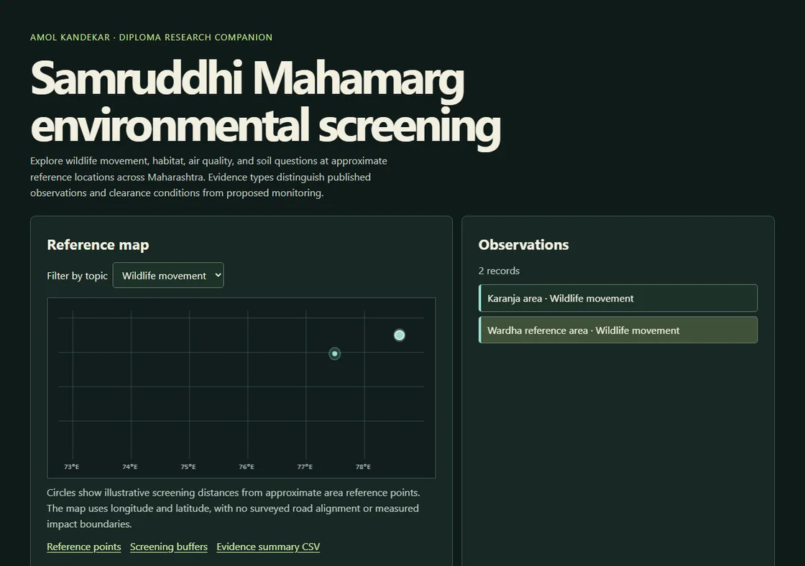

# Samruddhi Mahamarg Environmental Study

Amol Kandekar studied potential environmental effects of the Nagpur–Mumbai expressway as a civil engineering diploma project in 2020. The original study covered forest cover, air pollution, wildlife movement, and soil degradation using AutoCAD, Excel, and GIS. This public companion recreates the screening workflow and adds later published monitoring as a separately dated source.



## Run the dashboard

```sh
python build_report.py
python -m http.server 4173 --bind 127.0.0.1 --directory docs
```

Open `http://127.0.0.1:4173/`. Python 3.10 or later is sufficient. You can also open `docs/index.html` directly. The browser dashboard filters observations by topic and shows evidence, possible mitigation, and follow-up measurements alongside a reference map.

## Methods and outputs

- `data/screening.csv` records the evidence level, illustrative location, project phase, question, mitigation, and measurement. `data/sources.csv` gives the underlying primary references. A published traffic or environmental measurement would require its own source record and units.
- `docs/reference-sites.geojson` and `docs/screening-buffers.geojson` import into QGIS or ArcGIS as WGS 84 layers. The builder calculates spherical 5 km and 10 km buffers around approximate area coordinates. The circles support screening discussions, and actual analysis should substitute validated corridor geometry and a suitable coordinate system. The Wardha marker supplies geographic context for the WII reference.
- `docs/evidence-summary.csv` summarizes the count of records by topic and evidence type. Open it in Excel or join it to a workbook for monitoring design. Counts refer to evidence records in this companion.
- A future field assessment would join approved alignment and chainage to dated land-cover layers, use comparable seasonal imagery, sample air and drainage at paired sites, and measure wildlife observations per camera-day. Record dates, coordinates, instrument precision, and data gaps before comparing conditions.

## Primary references

- [National Board for Wildlife Standing Committee, 50th meeting, item 50.3.8.3](https://cpc.parivesh.nic.in/writereaddata/Order%20and%20Release/Minutes%20of%2050%20Meeting%20of%20the%20Standing%20Committee%20of%20National%20Board%20for%20Wildlife.pdf)
- [Wildlife Institute of India annual research seminar, 2024](https://v1.wii.gov.in/images/images/documents/announcements/ars_programme_abstracts_2024_hq.pdf)
- [Wildlife Institute of India annual research seminar, 2025](https://wii.gov.in/uploads/media/publications/36-ars-abstracts.pdf)
